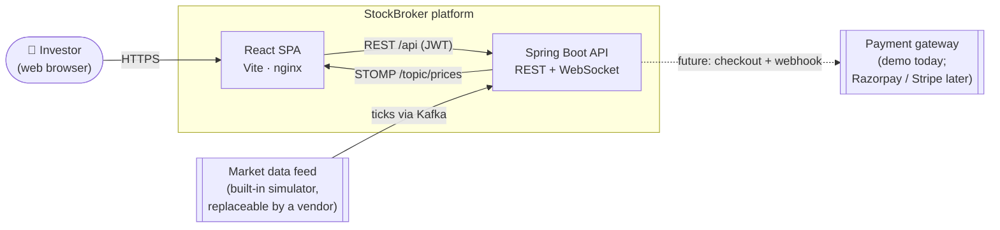
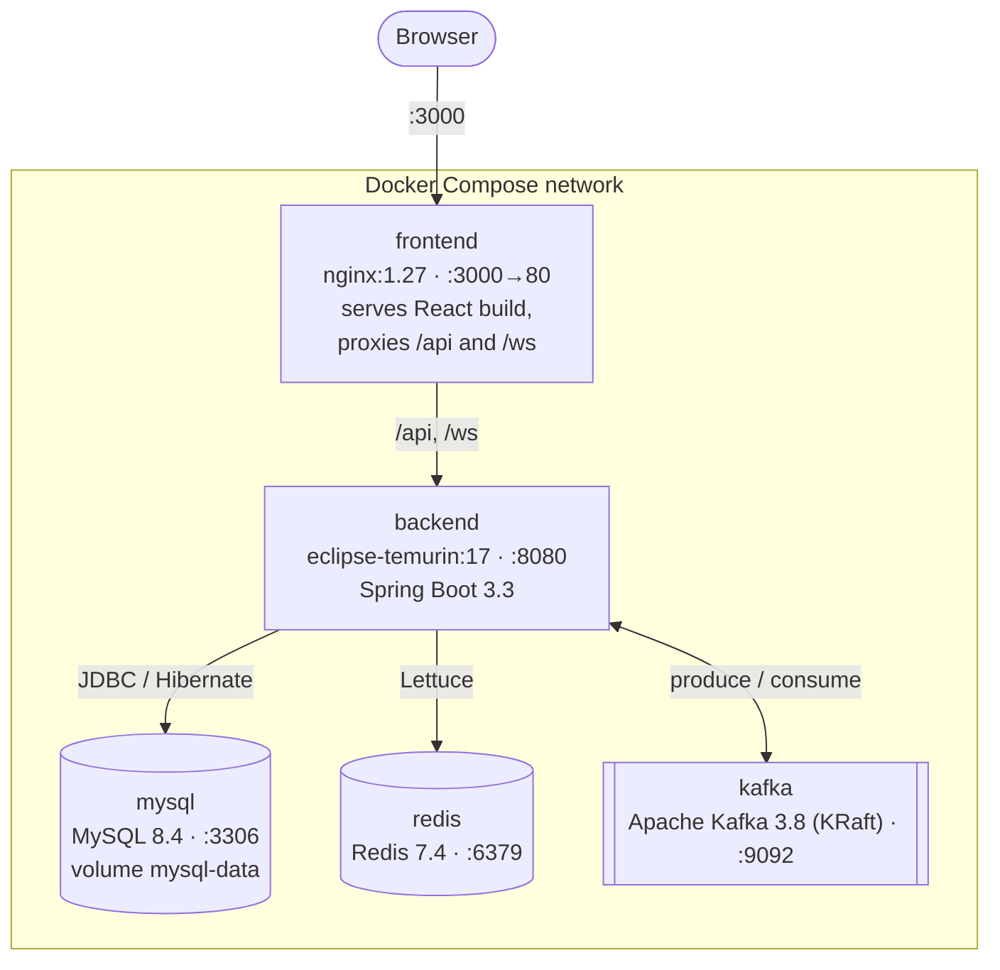
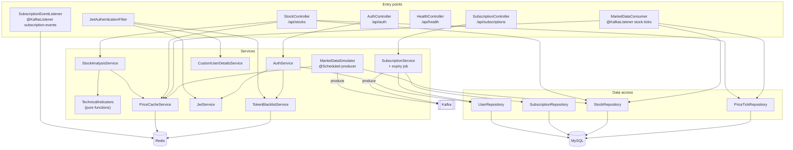
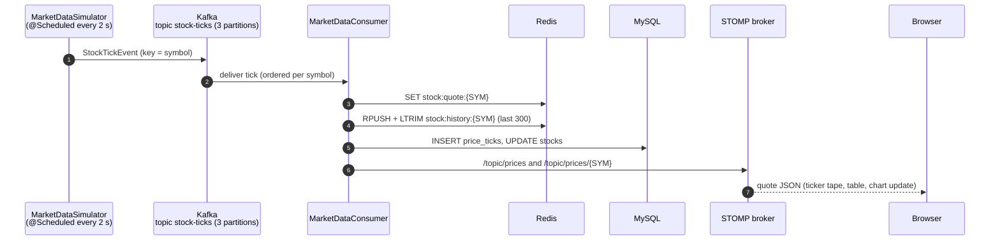
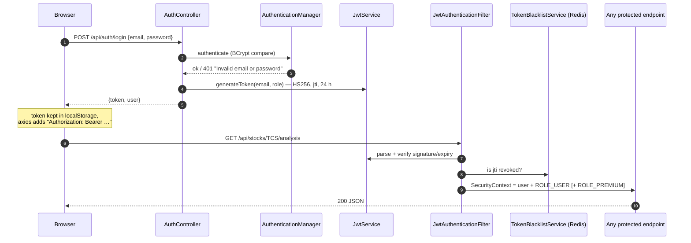
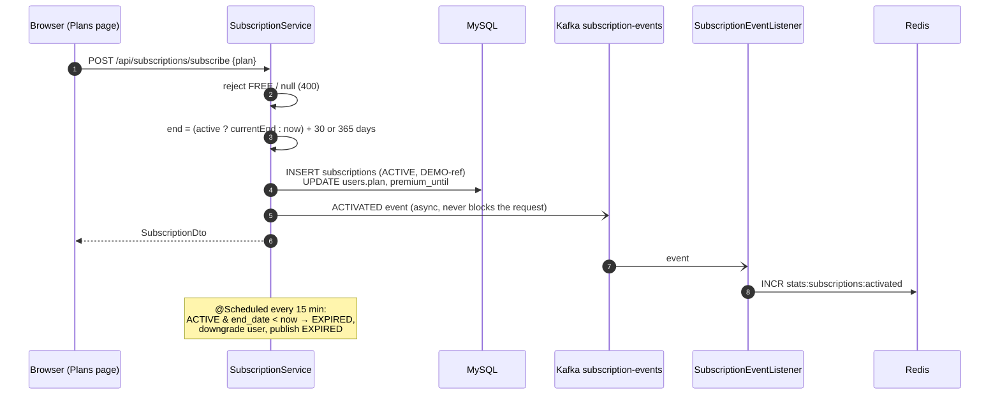
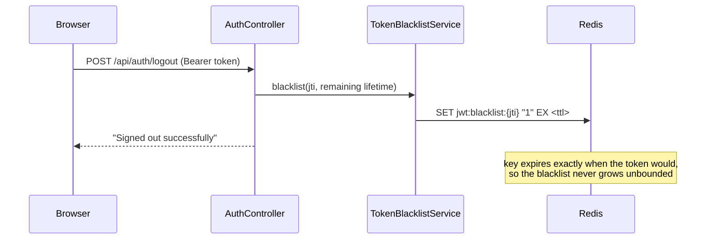
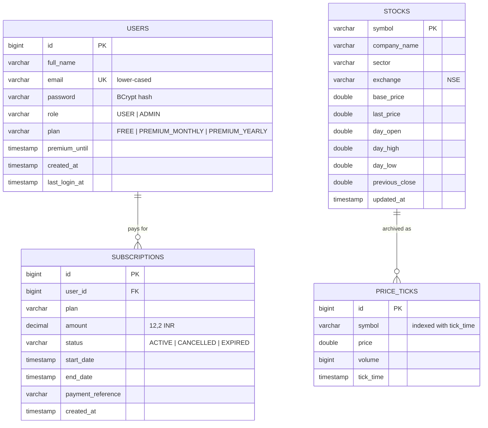
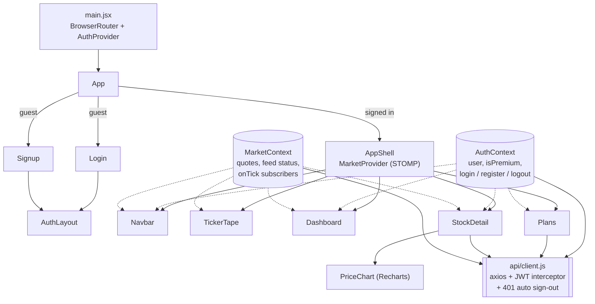
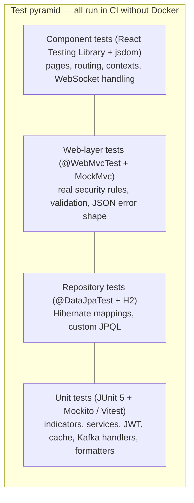

# StockBroker — Architecture

This document describes how StockBroker is built: the moving parts, how data flows between them, how users are authenticated, how the data is stored, and how the system is tested.

> **Interactive version:** the [project showcase page](https://shaikahmed807.github.io/stockbroker-app/) has a clickable architecture diagram, a live data-flow animation and an API explorer.

---

## 1. System at a glance

StockBroker is a full-stack web application that streams live (simulated) NSE stock prices to the browser, computes technical analysis on the fly, and sells a Premium plan that unlocks advanced indicators.

| Quality goal | How the design meets it |
|---|---|
| **Real-time** | Ticks travel Kafka → Redis → WebSocket in milliseconds; the browser never polls for prices |
| **Fast reads** | Hot data (quotes, last 300 ticks, analysis) lives in Redis; MySQL is the durable archive |
| **Decoupled** | Kafka separates the price feed from processing and billing from its side effects |
| **Secure** | Stateless JWT, BCrypt passwords, server-side token revocation, generic auth errors |
| **Resilient** | Redis outages degrade gracefully (MySQL fallback); Kafka failures never break a request |
| **Testable** | 200+ automated tests run on every push without any external infrastructure |

---

## 2. Containers and deployment

Everything runs with one `docker compose up --build`.

| Container | Image | Role | Health check |
|---|---|---|---|
| `frontend` | nginx 1.27 (multi-stage Node 20 build) | Static SPA + reverse proxy | — |
| `backend` | Temurin 17 JRE (multi-stage Maven build) | REST API, WebSocket, Kafka producer/consumer, schedulers | depends on the three below being healthy |
| `mysql` | mysql:8.4 | System of record | `mysqladmin ping` |
| `redis` | redis:7.4-alpine | Hot cache + token blacklist | `redis-cli ping` |
| `kafka` | apache/kafka:3.8.0 (KRaft, no ZooKeeper) | Event streaming | `kafka-topics.sh --list` |

---

## 3. Backend components

The backend follows a classic layered architecture: **controller → service → repository**, with security as a servlet filter in front and Kafka listeners as a second entry point.

| Package | Responsibility |
|---|---|
| `config` | Spring Security rules, CORS, Kafka topics, STOMP broker, first-run data seeding |
| `controller` | HTTP mapping, request validation (`@Valid`), principal extraction — no business logic |
| `service` | Business rules: auth, billing, analysis, market feed, caching |
| `security` | JWT issue/parse, revocation list, user → authorities mapping, request filter |
| `repository` | Spring Data JPA interfaces (Hibernate generates SQL) |
| `model` | JPA entities and enums (`User`, `Subscription`, `Stock`, `PriceTick`, `PlanType` …) |
| `dto` | Java records for requests, responses and Kafka events — entities are never serialised directly |
| `exception` | `ApiException` + `GlobalExceptionHandler` → one JSON error shape everywhere |

---

## 4. Key flows

### 4.1 Live market data pipeline

*Why Kafka here?* The simulator can be swapped for a real vendor feed by publishing the same JSON to `stock-ticks`; nothing downstream changes. Keying by symbol keeps each stock's ticks in order while three partitions allow parallel consumers.

### 4.2 Sign in and an authenticated request

### 4.3 Premium subscription

### 4.4 Sign out (stateless JWT revocation)

---

## 5. Data model

### 5.1 MySQL (Hibernate entities)

Indexes: `subscriptions(user_id)`, `subscriptions(status, end_date)` for the expiry job, `price_ticks(symbol, tick_time)` for history fallback.

### 5.2 Redis keys

| Key | Type | TTL | Written by | Read by |
|---|---|---|---|---|
| `stock:quote:{SYM}` | string (JSON `StockQuote`) | none | MarketDataConsumer | StockController, StockAnalysisService |
| `stock:history:{SYM}` | list of JSON `PricePoint`, capped at 300 | none | MarketDataConsumer, simulator backfill | StockController, StockAnalysisService |
| `stock:analysis:{SYM}:{free\|premium}` | string (JSON `AnalysisResponse`) | 2 s | StockAnalysisService | StockAnalysisService |
| `jwt:blacklist:{jti}` | string `"1"` | token's remaining life | TokenBlacklistService | JwtAuthenticationFilter |
| `stats:subscriptions:{type}` | counter | none | SubscriptionEventListener | ops / analytics |

### 5.3 Kafka topics

| Topic | Partitions | Key | Payload | Producer → Consumer group |
|---|---|---|---|---|
| `stock-ticks` | 3 | symbol | `StockTickEvent` | MarketDataSimulator → `stockbroker-market-data` |
| `subscription-events` | 1 | user id | `SubscriptionEvent` (`ACTIVATED` / `CANCELLED` / `EXPIRED`) | SubscriptionService → `stockbroker-subscriptions` |

---

## 6. Technical analysis engine

`TechnicalIndicators` is a set of pure, side-effect-free functions (easy to unit-test). `StockAnalysisService` feeds them the Redis price window and combines the results into a score from −100 to +100.

| Indicator | Free | Premium | Score contribution |
|---|:-:|:-:|---|
| SMA 20 / SMA 50, EMA 20, trend | ✅ | ✅ | SMA20 > SMA50: +20 / −20 · price > SMA20: +10 / −10 |
| RSI 14 (Wilder) | | ✅ | < 30: +25 (oversold) · > 70: −25 (overbought) |
| MACD 12/26/9 | | ✅ | histogram > 0: +20 / −20 |
| Bollinger Bands 20, 2σ | | ✅ | at lower band +15 · at upper band −15 |
| Momentum 10, volatility, support / resistance | | ✅ | momentum > 0.3 %: +10 · < −0.3 %: −10 |

Signal: ≥ 50 `STRONG_BUY`, ≥ 20 `BUY`, ≤ −50 `STRONG_SELL`, ≤ −20 `SELL`, otherwise `HOLD`. Every Premium signal comes with the list of reasons that produced it.

---

## 7. Frontend architecture

- **State** lives in two React contexts: `AuthContext` (session) and `MarketContext` (one WebSocket for the whole app, quotes keyed by symbol, plus a tiny pub/sub so the chart can append ticks).
- **Routing:** `GuestOnly` keeps signed-in users away from `/login` and `/signup`; `AppShell` redirects guests to `/login`.
- **Resilience:** the STOMP client reconnects every 3 s; the navbar shows Live / Connecting / Reconnecting.

---

## 8. Security model

| Concern | Control |
|---|---|
| Passwords | BCrypt (Spring Security `BCryptPasswordEncoder`), never returned by any DTO |
| Sessions | Stateless JWT (HS256), 24 h, unique `jti`; no server session, CSRF disabled accordingly |
| Sign out | `jti` blacklisted in Redis for the token's remaining life; **fails closed** if Redis is down |
| Authorisation | `ROLE_USER` for every account, `ROLE_PREMIUM` only while `premium_until` is in the future |
| Public endpoints | `register`, `login`, `GET /subscriptions/plans`, `/ws/**` — everything else needs a token |
| Errors | One JSON shape; credentials errors are generic; unexpected errors never leak stack traces |
| Input | Bean Validation on every request body (email format, password 8–64 chars with letter + digit) |
| CORS | Allow-list from `CORS_ALLOWED_ORIGINS` |

**Known gaps before production** (also listed in the README): move the JWT to an httpOnly cookie, rotate `JWT_SECRET`, add rate limiting on `/login`, real payment verification via gateway webhook.

---

## 9. Testing architecture

| Layer | Tools | What is covered |
|---|---|---|
| Backend unit | JUnit 5, Mockito, AssertJ | Indicator maths, analysis scoring and caching, auth rules, billing rules (extend vs new, cancel, expiry job), JWT tamper/expiry, blacklist fail-closed, Kafka producer/consumer logic, Redis key layout |
| Backend web | `@WebMvcTest`, MockMvc, Spring Security Test | Every endpoint's status codes, public vs protected routes, Free vs Premium tiers, validation messages, malformed JSON |
| Backend data | `@DataJpaTest`, H2 | Case-insensitive email lookup, expiry query, newest-first history, tick paging |
| Frontend | Vitest, React Testing Library, user-event | Form validation, sign-in/out, dashboard search/sort/breadth, Premium lock vs unlocked analysis, plan purchase/cancel dialog, routing guards, live WebSocket updates, API client and interceptors |

Run locally: `cd backend && mvn verify` · `cd frontend && npm test`. CI runs both on every push and publishes coverage reports (JaCoCo, V8) as build artifacts.

---

## 10. Design decisions

| # | Decision | Why | Trade-off |
|---|---|---|---|
| 1 | Redis as the hot store, MySQL as archive | Sub-millisecond reads for 12 stocks × 300 ticks; MySQL keeps full history | Two writes per tick; Redis restart needs MySQL fallback (implemented) |
| 2 | Kafka between feed and processing | Swap simulator for a vendor without code changes; replay & scale consumers | Extra infrastructure for a small demo |
| 3 | Stateless JWT + Redis blacklist | Horizontal scaling without sticky sessions, yet real logout | Redis becomes part of the auth path (fail-closed) |
| 4 | Analysis computed on request, cached 2 s | Always fresh, cheap (one tick interval) | Recomputed per tier per symbol every tick |
| 5 | DTO records, never entities, over the wire | No accidental password/lazy-loading leaks | A little mapping code |
| 6 | Simulated payments behind one method | Product flow works end-to-end today; one place to plug a gateway | Not production billing yet |

---

## 11. Scaling path

1. Run 2+ backend instances behind the load balancer — JWT is stateless; switch the in-memory STOMP broker to a Redis or RabbitMQ relay so every instance can push to every browser.
2. Raise `stock-ticks` partitions with the number of consumers.
3. Partition or TTL-prune `price_ticks`; replace `ddl-auto: update` with Flyway migrations.
4. Redis with replication/persistence; Kafka with 3 brokers and replication factor 3.
