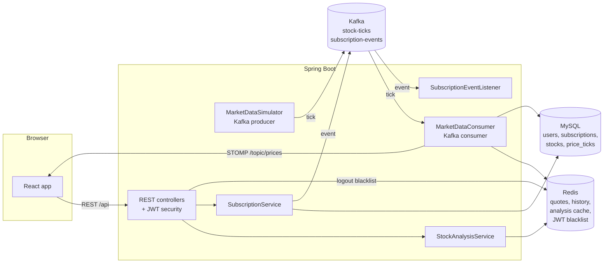

# StockBroker

[](https://github.com/shaikahmed807/stockbroker-app/actions/workflows/ci.yml)


A full-stack stock broking web application with live prices, technical analysis and a paid Premium plan.

| | |
|---|---|
| 🎯 **Interactive showcase** (for reviewers and managers) | **https://shaikahmed807.github.io/stockbroker-app/** — clickable architecture, live analysis demo, API explorer, test dashboard |
| 🏗 **Architecture** | [ARCHITECTURE.md](ARCHITECTURE.md) — containers, components, sequence diagrams, data model, security, testing |
| ✅ **Tests** | 230+ automated tests run on every push — see [Testing](#testing) |

**Stack:** Spring Boot 3 · Hibernate (JPA) · MySQL 8 · Redis 7 · Apache Kafka 3.8 · React 18 (Vite)

| Feature | What it does |
|---|---|
| Sign up / Sign in | Create an account, sign in with email + password (BCrypt-hashed), JWT issued on success |
| Log out / Sign out | Token is revoked server-side by blacklisting its id in Redis until it would expire |
| Premium subscription | Monthly (₹499) or yearly (₹4,999) plan; extends if already active; cancel anytime; auto-expiry job |
| Live stock analysis | Prices stream over Kafka → Redis → WebSocket; SMA/EMA/trend for everyone; RSI, MACD, Bollinger Bands, volatility, support/resistance and a buy/sell signal for Premium |

> **Market data is simulated.** A built-in feed generates realistic random-walk prices for 12 NSE large caps every 2 seconds so the app works without a paid data vendor. See [Using real market data](#using-real-market-data).

---

## Architecture



**How each technology is used**

- **Spring Boot** – REST API, scheduling, WebSocket (STOMP) push, Spring Security with stateless JWT.
- **Hibernate / JPA** – entities `User`, `Subscription`, `Stock`, `PriceTick`; schema auto-created (`ddl-auto: update`).
- **MySQL** – durable store for accounts, billing history, stock master data and the full tick archive.
- **Redis** – hot market data (latest quote + last 300 ticks per stock), 2-second analysis cache, JWT logout blacklist, subscription counters.
- **Kafka** – `stock-ticks` topic (keyed by symbol, 3 partitions) decouples the price feed from processing; `subscription-events` topic carries ACTIVATED / CANCELLED / EXPIRED events to downstream consumers.
- **React** – Vite SPA with React Router, Recharts live chart, `@stomp/stompjs` WebSocket client.

---

## Project structure

```
stockbroker-app/
├── docker-compose.yml          # MySQL, Redis, Kafka, backend, frontend
├── backend/                    # Spring Boot (Java 17, Maven)
│   ├── pom.xml
│   ├── Dockerfile
│   └── src/main/java/com/stockbroker/
│       ├── config/             # Security, Kafka topics, WebSocket, data seeding
│       ├── controller/         # Auth, Stock, Subscription, Health
│       ├── dto/                # Request/response records + Kafka events
│       ├── exception/          # ApiException + global error handler
│       ├── model/              # Hibernate entities and enums
│       ├── repository/         # Spring Data JPA repositories
│       ├── security/           # JWT service, filter, blacklist, user details
│       └── service/            # Auth, subscriptions, market feed, analysis
└── frontend/                   # React 18 + Vite
    ├── Dockerfile, nginx.conf
    └── src/
        ├── api/client.js       # axios + JWT interceptor
        ├── context/            # AuthContext, MarketContext (WebSocket)
        ├── components/         # Navbar, TickerTape, PriceChart
        └── pages/              # Login, Signup, Dashboard, StockDetail, Plans
```

---

## Run it

### Option A — everything in Docker (easiest)

Requires Docker Desktop.

```bash
docker compose up --build
```

Open **http://localhost:3000**. First start takes a few minutes while Maven and npm download dependencies.

### Option B — run backend and frontend locally

Requires **Java 17+**, **Maven 3.9+**, **Node 18+**.

1. Start the infrastructure only:
   ```bash
   docker compose up -d mysql redis kafka
   ```
   (Or use your own MySQL on 3306 with user `root` / password `root`, Redis on 6379 and Kafka on 9092.)

2. Start the backend:
   ```bash
   cd backend
   mvn spring-boot:run
   ```
   API runs on http://localhost:8080. Tables are created automatically and 12 stocks plus a demo user are seeded.

3. Start the frontend (new terminal):
   ```bash
   cd frontend
   npm install
   npm run dev
   ```
   Open **http://localhost:5173**. Vite proxies `/api` and `/ws` to the backend.

### Demo account

| Email | Password |
|---|---|
| demo@stockbroker.com | Demo@1234 |

Or create your own account on the sign-up page.

### Run the tests

```bash
cd backend && mvn verify      # JUnit 5 + Mockito + MockMvc + H2, coverage in target/site/jacoco
cd frontend && npm test       # Vitest + React Testing Library
```

---

## Configuration

All settings are in `backend/src/main/resources/application.yml` and can be overridden with environment variables:

| Variable | Default | Purpose |
|---|---|---|
| `DB_URL` | `jdbc:mysql://localhost:3306/stockbroker?...` | MySQL connection |
| `DB_USERNAME` / `DB_PASSWORD` | `root` / `root` | MySQL credentials |
| `REDIS_HOST` / `REDIS_PORT` | `localhost` / `6379` | Redis |
| `KAFKA_BOOTSTRAP_SERVERS` | `localhost:9092` | Kafka |
| `JWT_SECRET` | demo key | Base64 key, ≥ 32 bytes. **Change for any real deployment** (`openssl rand -base64 48`) |
| `JWT_EXPIRATION_MS` | `86400000` (24 h) | Token lifetime |
| `CORS_ALLOWED_ORIGINS` | `http://localhost:5173,http://localhost:3000` | Allowed browser origins |
| `MARKET_SIMULATOR_ENABLED` | `true` | Turn the built-in price feed on/off |
| `MARKET_TICK_INTERVAL_MS` | `2000` | Time between ticks |

---

## REST API

All endpoints except sign-up, sign-in and the plan list need `Authorization: Bearer <token>`.

| Method | Path | Description |
|---|---|---|
| POST | `/api/auth/register` | Sign up `{fullName, email, password}` → `{token, user}` |
| POST | `/api/auth/login` | Sign in `{email, password}` → `{token, user}` |
| POST | `/api/auth/logout` | Sign out (revokes current token) |
| GET | `/api/auth/me` | Current user |
| GET | `/api/stocks` | All stocks with latest quote |
| GET | `/api/stocks/{symbol}` | One quote |
| GET | `/api/stocks/{symbol}/history?limit=300` | Price history (Free: 60 points, Premium: 300) |
| GET | `/api/stocks/{symbol}/analysis` | Live analysis (premium fields `null` + `premiumLocked: true` on Free) |
| GET | `/api/subscriptions/plans` | Plans and prices (public) |
| GET | `/api/subscriptions/me` | Current plan, expiry, days left |
| GET | `/api/subscriptions/history` | Billing history |
| POST | `/api/subscriptions/subscribe` | `{plan: "PREMIUM_MONTHLY" \| "PREMIUM_YEARLY"}` |
| POST | `/api/subscriptions/cancel` | Cancel Premium |
| GET | `/api/health` | MySQL + Redis status |

**WebSocket:** STOMP at `/ws`; subscribe to `/topic/prices` (all stocks) or `/topic/prices/{SYMBOL}`.

Example:

```bash
TOKEN=$(curl -s -X POST localhost:8080/api/auth/login -H 'Content-Type: application/json' \
  -d '{"email":"demo@stockbroker.com","password":"Demo@1234"}' | sed -E 's/.*"token":"([^"]+)".*/\1/')
curl -s localhost:8080/api/stocks/TCS/analysis -H "Authorization: Bearer $TOKEN"
```

---

## Going to production

### Real payments
`SubscriptionService.subscribe()` currently activates the plan with a `DEMO-` payment reference and no charge — the UI never collects card details. To take real payments with Razorpay or Stripe:
1. Add an endpoint that creates a gateway order for the chosen plan.
2. Open the gateway's hosted checkout from `Plans.jsx` instead of the demo confirm button.
3. Verify the gateway's signature/webhook on the backend, then run the existing activation logic with the gateway's payment id.

### Using real market data
Set `MARKET_SIMULATOR_ENABLED=false` and publish ticks from your data vendor (e.g. a broker's WebSocket API) to the `stock-ticks` topic in this JSON shape — the rest of the pipeline works unchanged:

```json
{"symbol":"TCS","price":4102.5,"open":4090,"high":4110,"low":4085,"previousClose":4080,"volume":125000,"timestamp":1730000000000}
```

### Other hardening
- Replace `ddl-auto: update` with Flyway/Liquibase migrations.
- Partition or prune `price_ticks` (it grows by every tick).
- Store the JWT in an httpOnly cookie instead of `localStorage`.
- Run multiple Kafka brokers and Redis with persistence/replication.

---

## Testing

No MySQL, Redis or Kafka is needed to run the tests — they are mocked or replaced by an in-memory H2 database. GitHub Actions runs both suites on every push and attaches JUnit, JaCoCo and V8 coverage reports to each run.

| Layer | Tools | Tests | Examples |
|---|---|---:|---|
| Backend unit | JUnit 5, Mockito, AssertJ | 116 | indicator maths, analysis scoring + caching, billing rules (extend, cancel, expiry job), JWT tamper/expiry, logout blacklist fails closed, Kafka producer/consumer |
| Backend web layer | `@WebMvcTest`, MockMvc, Spring Security Test | 31 | every endpoint's status codes, public vs protected routes, Free vs Premium tiers, validation messages |
| Backend database | `@DataJpaTest`, H2 | 6 | Hibernate mappings, case-insensitive email, expiry JPQL query, tick paging |
| Frontend | Vitest, React Testing Library, user-event | 84 | sign-in/up validation, dashboard search/sort, Premium lock, plan purchase/cancel, route guards, live WebSocket updates |

```
backend/src/test/java/com/stockbroker/
├── controller/   AuthControllerTest, StockControllerTest, SubscriptionControllerTest
├── repository/   RepositoryIntegrationTest (H2)
├── security/     JwtServiceTest, JwtAuthenticationFilterTest, TokenBlacklistServiceTest, CustomUserDetailsServiceTest
├── service/      TechnicalIndicators, StockAnalysis, Subscription, Auth, PriceCache, MarketData* tests
├── model/        DomainModelTest
└── exception/    GlobalExceptionHandlerTest
frontend/src/__tests__/   App, AuthContext, MarketContext, Login, Signup, Dashboard, StockDetail, Plans, Navbar, client, format
```

---

## Get the code

```bash
git clone https://github.com/shaikahmed807/stockbroker-app.git
cd stockbroker-app
docker compose up --build
```

---

*Analysis and signals in this app are generated from simulated data for learning purposes and are not investment advice.*
